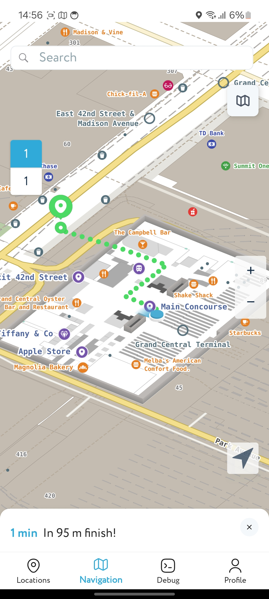
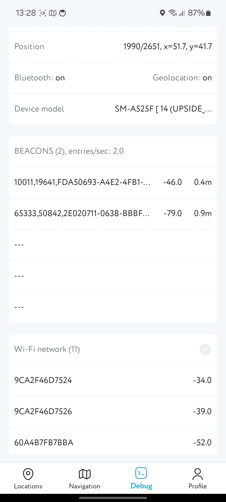

# Navigine Demo — Java / XML

A stable reference app showcasing the [Navigine Indoor Navigation SDK](https://github.com/Navigine/Indoor-Navigation-Android-Mobile-SDK-2.0) with a traditional Java/XML stack.

[](https://android-arsenal.com/api?level=23)
[](https://www.java.com)
[](https://developer.android.com)
[](https://github.com/Navigine/Indoor-Navigation-Android-Mobile-SDK-2.0)

> **Looking for a modern stack?** Check out [NavigineDemoCompose](../NavigineDemoCompose/) — the actively maintained Kotlin/Compose version of this demo.

---

## Screenshots

&nbsp;&nbsp;

---

## What's inside

| Screen         | Description                                        |
|----------------|----------------------------------------------------|
| **Navigation** | Indoor map, route building and turn-by-turn hints  |
| **Locations**  | Browse and select a location                       |
| **Debug**      | Live position, sensors, signals                    |

---

## SDK features demonstrated

| Feature                     | SDK API                                                                                   |
|-----------------------------|-------------------------------------------------------------------------------------------|
| Map with built-in controls  | `DefaultNavigationView` — zoom controls, floor selector, follow-me button, user location  |
| Route drawing and guidance  | `RouteLayer` — `setTarget`, `RouteLayerListener` (route updates, progress, arrival)       |
| Route hints                 | `RouteView.annotations()` + `RouteProgress` (advance, remaining distance and time)        |
| Map input                   | `InputListener` (tap / long tap), `PickListener` (venue picking)                          |
| Coordinates                 | `GlobalPoint` (WGS84) on the map, `Sublocation.localToGlobal / globalToLocal` conversion  |
| Venue filtering, 3D mode    | `LocationWindow.applyLayerFilter`                                                         |

---

## Tech Stack

- **Language:** Java
- **UI:** XML Views, Fragments
- **Architecture:** Traditional Android (Activity/Fragment)
- **State:** Callbacks, Handler

---

## Getting Started

**1. Clone and open in Android Studio:**

```bash
git clone https://github.com/Navigine/Indoor-Navigation-Android-Mobile-SDK-2.0.git
cd Indoor-Navigation-Android-Mobile-SDK-2.0/NavigineDemo
```

**2. Configure the SDK** — enter your server URL and user hash on the Login screen.

> Don't have credentials? [Get started at locations.navigine.com](https://locations.navigine.com/login)

**3. Build and run on a real device** — recommended for BLE and sensor features.

---

## Working with the SDK

A few things worth knowing if you use this demo as a starting point for your own app.

**Keep references to your listeners.** The SDK does not keep your listener objects alive. A listener passed as an anonymous object and not stored anywhere can be garbage-collected, after which its callbacks silently stop arriving. Store listeners in fields and remove them in the matching lifecycle method:

```java
private InputListener inputListener;

@Override
public View onCreateView(...) {
    inputListener = new InputListener() { /* ... */ };
    locationView.getLocationWindow().addInputListener(inputListener);
    ...
}

@Override
public void onDestroyView() {
    locationView.getLocationWindow().removeInputListener(inputListener);
    inputListener = null;
    super.onDestroyView();
}
```

**Map coordinates are WGS84.** Map objects, the camera and screen conversions work with `GlobalPoint` plus an optional sublocation id (`null` means outdoors). Venues, positions and the `RouteManager` still use local metric coordinates (`LocationPoint`). Convert at the boundary with `Sublocation.localToGlobal` / `globalToLocal`.

**Let `RouteLayer` draw the route.** It builds the route from the current position, redraws it when the user deviates or changes floors, and reports progress and arrival. You don't need to build polylines from `RoutePath` manually.

**`flyTo` duration is in milliseconds.**

---

## Migrating from SDK versions before 2.27

| Before                                              | Now                                                              |
|-----------------------------------------------------|------------------------------------------------------------------|
| `screenPositionToMeters(PointF)` → `Point`          | `screenPositionToGlobal(PointF)` → `GlobalPoint`                 |
| `metersToScreenPosition(Point, boolean)`            | `globalToScreenPosition(GlobalPoint, boolean)`                   |
| `IconMapObject.setPosition(LocationPoint)`          | `setPosition(GlobalPoint, Integer sublocationId)`                |
| `new LocationPolyline(Polyline, locationId, subId)` | `new LocationPolyline(ArrayList<GlobalPoint>, Integer subId)`    |
| `new Camera(Point, zoom, rotation)`                 | `new Camera(GlobalPoint, zoom, rotation, tilt)`                  |
| `setColor(r, g, b, a)` (floats)                     | `setColor(int argb)`                                             |
| `RouteListener` + manual `DottedPolylineMapObject`  | `RouteLayer` + `RouteLayerListener`                              |

See the [SDK changelog](https://github.com/Navigine/Indoor-Navigation-Android-Mobile-SDK-2.0) for the full list of changes.

---

## Permissions

| Permission                             | Reason                             |
|----------------------------------------|------------------------------------|
| `ACCESS_FINE_LOCATION`                 | Indoor positioning                 |
| `BLUETOOTH_SCAN` / `BLUETOOTH_CONNECT` | BLE beacon scanning (Android 12+)  |
| `ACCESS_BACKGROUND_LOCATION`           | Background positioning (if needed) |

---

## Troubleshooting

**No beacons** — ensure Bluetooth and Location are enabled and battery optimizations are disabled for the app.

**Blank map** — verify your server URL, user hash, and that the selected location ID is valid.

**Taps or other callbacks stop working after a while** — a listener was garbage-collected. Keep it in a field (see [Working with the SDK](#working-with-the-sdk)).

**No route is drawn** — routing starts from the current position, so make sure a position is available (the user location marker is visible) and that the location has a navigation graph.